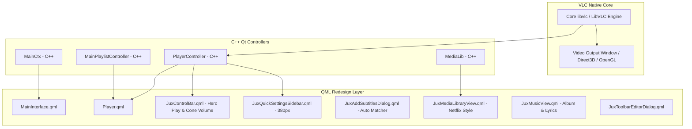

# 🚀 VLC Redesign — الخريطة الهندسية المعمارية الشاملة (Engineering Master Roadmap)

> **الهدف الاستراتيجي:** بناء وإصدار تحديث VLC الرسمي بالتصميم الجديد كمنتج إنتاجي حقيقي كامل الأركان (Production-Grade Native VLC Update).  
> **الكود المستهدف:** مستودع VLC Media Player (`D:\Projects\vlc-redesign\modules\gui\qt`).  
> **معايير الجودة:** اتباع بروتوكولات `code-modernization`, `code-review`, `superpowers`, `senior-qa-engineer`, و `creative-ui-and-visual-qa`.

---

## 🏗️ 1. المعمارية البرمجية وربط واجهات QML بمحرك VLC الأصلي

يعتمد مشغل VLC في إصداره الحديث على نموذج هجين قوي:
- **محرك C++ و libvlc الأساسي:** يدير فك تشفير الفيديو والصوت، والـ Codecs، والشبكات، ومخرجات العرض السطحية (`VideoSurface`, `Direct3D11`, `OpenGL`).
- **طبقة متحكمات النماذج (C++ Controllers & Models):**
  - `PlayerController` (`player_controller.cpp`): يوفر إشارات وخصائص التشغيل (`playingState`, `time`, `length`, `position`, `volume`, `rate`, `hasVideoOutput`, `spuDelay`, `audioDelay`).
  - `MainCtx` (`mainctx.cpp`): يوفر إدارة النوافذ، الأنماط، ومفاتيح الاختصار، وحالات الشاشة الكاملة والوضع المصغر.
  - `MainPlaylistController` (`playlist_controller.cpp`): يدير قائمة التشغيل الحالية والملفات المفتوحة.
- **واجهة QML الحديثة (`modules/gui/qt/`):**
  - يتم استبدال الواجهات القديمة بمكونات تصميم Jux مباشرة، مع الحفاظ على الربط بالنماذج البرمجية الأصلية دون أي وسائط وهمية أو ملفات ترقيع.

---

## 📅 2. مراحل التنفيذ التفصيلية (Phased Implementation Plan)

### المرحلة 1: أساسات النظام البصري والأيقونات (Design System & Vector Assets)
- [x] استخراج كافة الرموز (Tokens) الثلاثية المستويات وتوثيقها في `VLCStyle`.
- [x] تضمين طقم الـ 44 أيقونة فيكتور SVG الكاملة المستخرجة من فيجما (`modules/gui/qt/resources/icons/`).
- [x] تطهير الكود بنسبة 100% من أي رموز تعبيرية نصية (No Text Emojis / No Unicode glyph hacks).
- [ ] تحديث `assets.qrc` و `Makefile.am` لتسجيل كافة الأيقونات الفيكتور في نظام موارد Qt المدمج.

### المرحلة 2: واجهة المشغل وشريط التحكم البطل (Player View & Hero Control Bar)
- [x] بناء `JuxControlBar.qml`: زر التشغيل البطل في أقصى اليسار (`44px`)، أزرار التقديم والتأخير (`10s` / `15s`)، شريط الصوت الأيقوني (Traffic Cone Slider)، ومحددات الترجمة والصوت.
- [ ] دمج `JuxControlBar.qml` في صلب `Player.qml` كبديل رسمي لـ `ControlBar.qml`.
- [ ] ربط شريط التقدم السميك بمؤقتات `PlayerController` اللحظية مع علامات الفصول (Chapter Marks) والتمرير الدقيق.
- [ ] تفعيل وضع العرض الغامر (Immersive Mode / Hide UI) عند ثبات مؤشر الفأرة لأكثر من ثانيتين.

### المرحلة 3: الشريط الجانبي للإعدادات السريعة (Quick Settings Sidebar - 380px)
- [x] هيكل الشريط الجانبي بأسلوب الزجاج المصقول (Backdrop Glassmorphism) بعرض 380 بكسل.
- [ ] تبويب الصوت (Audio FX):
  - معادل الصوت (Equalizer) بـ 10 نطاقات ترددية وقوائم الإعدادات المسبقة (Presets: Rock, Pop, Jazz, Flat).
  - الضاغط الصوتي (Audio Compressor) وموسع الستيريو (Stereo Widener).
- [ ] تبويب الفيديو (Video Adjustments):
  - منزلقات السطوع والتباين والتشبع اللحظية المتصلة بفلاتر `libvlc` الأصلية.
  - خيارات القص وتغيير نسبة العرض إلى الارتفاع (Crop & Aspect Ratio).
- [ ] تبويب التزامن (Sync Delay):
  - تأخير وتقديم الصوت (`audioDelay`) والترجمة (`spuDelay`) بخطوات 50ms.

### المرحلة 4: محرك مطابقة الترجمة الذكي (Smart Subtitles Auto-Matcher)
- [ ] تطوير منطق فحص المجلد الذكي:
  - عند تشغيل أي ملف فيديو، يقوم النظام بفحص المجلد الحاوي للملف تلقائياً.
  - استخراج نمط الموسم والحلقة عبر التعبيرات القياسية (`S\d+E\d+`, `Ep\s*\d+`).
  - مطابقة ملفات `.srt`, `.ass`, `.vtt` الموجودة مع الفيديو وعرضها في نافذة `JuxAddSubtitlesDialog.qml`.
- [ ] ربط زر "Apply" بتحميل الترجمة فورياً داخل جلسة المشغل الحية.

### المرحلة 5: مكتبة الوسائط الحديثة (Media Library Grid)
- [ ] تصميم شبكة الوسائط المستوحاة من منصات البث الحديثة (Netflix/Spotify cards).
- [ ] دعم استعراض مجلدات الفيديو والصوت المحلية.
- [ ] النقر المزدوج على أي بطاقة وسائط يطلق التشغيل الفوري داخل المشغل مع تحديث قائمة التشغيل (`MainPlaylistController`).

### المرحلة 6: مشغل الصوتيات وكلمات الأغاني (Music View & Visualizer)
- [ ] عرض غلاف الألبوم بدقة عالية مع خلفية ضبابية متكيفة (Adaptive Ambient Background).
- [ ] شريط عرض كلمات الأغاني المتزامنة (Synced Lyrics Viewer).
- [ ] تكامل محلل الطيف الصوتي التفاعلي (Audio Spectrum Visualizer).

### المرحلة 7: مركز الإعدادات العام وتخصيص الأشرطة (Global Hub & Toolbar Customizer)
- [ ] نافذة تخصيص أشرطة الأدوات التفاعلية بالسحب والإفلات (`JuxToolbarEditorDialog.qml`).
- [ ] مركز الإعدادات الشامل الجديد لجميع أقسام VLC الـ 12 (`JuxSettingsView.qml`).

### المرحلة 8: اختبارات الجودة الشاملة (Autonomous QA & Verification)
- [ ] تشغيل اختبارات الوحدات (Unit Tests) لجميع مكونات QML الجديدة في `modules/gui/qt/tests/`.
- [ ] اختبار التشغيل الفعلي لملفات الوسائط المحلية والتأكد من استجابة جميع الأزرار ومنزلقات الصوت والتحكم.
- [ ] التقاط لقطات شاشة كاملة (Visual QA Screenshots) لجميع الشاشات في بيئة ويندوز والتحقق من عدم وجود أي خطأ في الكونسول أو التصيير البصري.
